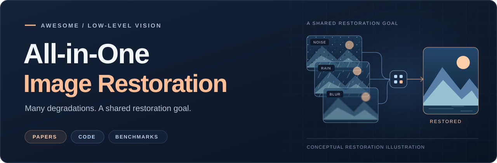

  

  
  
  
  

  <strong>A curated guide to unified image restoration across degradations and domains.</strong> 
  Methods · Vision-language models · Agents · Datasets · Metrics

  <a href="#explore"><strong>Explore the collection</strong></a> &nbsp; · &nbsp;
  <a href="#start-here">Reading routes</a> &nbsp; · &nbsp;
  <a href="#research-groups-in-china">Research groups</a> &nbsp; · &nbsp;
  <a href="#benchmarks-and-metrics">Evaluate</a> &nbsp; · &nbsp;
  <a href="#recent-updates">What's new</a> &nbsp; · &nbsp;
  <a href="CONTRIBUTING.md">Contribute</a>

> ⭐ **From the maintainers:** **Unified** — [Perceive-IR](https://arxiv.org/abs/2408.15994) · [ClearAIR](https://arxiv.org/abs/2601.02763) · [ClusIR](https://arxiv.org/abs/2512.10948) · [ProRes](https://arxiv.org/abs/2306.13653) | **Underwater** — [UniUIR](https://ieeexplore.ieee.org/document/11202372) | **Agentic** — [PreActIR](https://arxiv.org/abs/2610.20384)

Browse papers by topic and publication year. Each paper appears once; **Code** links to released implementations, while **Project** links to informational pages.

## Explore

<!-- NAVIGATION_START -->

<table width="100%">
  <tr>
    <td width="50%" valign="top"><a href="#all-in-one-image-restoration"><strong>🧩 All-in-One Restoration</strong></a> 74 papers · Unified models and experts</td>
    <td width="50%" valign="top"><a href="#adverse-weather-removal"><strong>🌦️ Adverse Weather</strong></a> 31 papers · Rain · haze · snow</td>
  </tr>
  <tr>
    <td width="50%" valign="top"><a href="#agentic-image-restoration"><strong>🤖 Agentic Restoration</strong></a> 11 papers · Planning · tools · feedback</td>
    <td width="50%" valign="top"><a href="#medical-image-restoration"><strong>🩺 Medical Imaging</strong></a> 10 papers · Medical image enhancement</td>
  </tr>
  <tr>
    <td width="50%" valign="top"><a href="#remote-sensing-and-hyperspectral-restoration"><strong>🛰️ Remote Sensing &amp; Hyperspectral</strong></a> 4 papers · Satellite · spectral imagery</td>
    <td width="50%" valign="top"><a href="#microscopy-and-bioimage-restoration"><strong>🔬 Microscopy &amp; Bioimaging</strong></a> 3 papers · Cells · fluorescence</td>
  </tr>
  <tr>
    <td width="50%" valign="top"><a href="#underwater-image-restoration"><strong>🌊 Underwater Imaging</strong></a> 3 papers · Color · visibility</td>
    <td width="50%" valign="top"><a href="#document-image-restoration"><strong>📄 Document Restoration</strong></a> 1 paper · Document enhancement</td>
  </tr>
  <tr>
    <td width="50%" valign="top"><a href="#video-restoration"><strong>🎞️ Video Restoration</strong></a> 6 papers · Temporal restoration</td>
    <td width="50%" valign="top"><a href="#continual-image-restoration"><strong>🔄 Continual &amp; Open-World</strong></a> 3 papers · Adaptation · retention</td>
  </tr>
  <tr>
    <td width="50%" valign="top"><a href="#cultural-heritage-image-restoration"><strong>🎨 Cultural Heritage</strong></a> 2 papers · Art · murals</td>
    <td width="50%" valign="top"><a href="#downstream-vision-under-adverse-weather"><strong>🎯 Downstream Vision</strong></a> 2 papers · Detection · segmentation</td>
  </tr>
  <tr>
    <td width="50%" valign="top"><a href="#vision-language-and-instruction-guided-restoration"><strong>💬 Language &amp; Instructions</strong></a> Text guidance · vision-language priors</td>
    <td width="50%" valign="top"><a href="#benchmarks-and-metrics"><strong>📊 Benchmarks &amp; Metrics</strong></a> 2 reports · 19 datasets · 5 metrics</td>
  </tr>
</table>

<!-- NAVIGATION_END -->

## Start here

| Your goal | Suggested route |
| --- | --- |
| 🧩 **Unified models** | [AirNet](https://pengxi.me/wp-content/uploads/2022/03/All-In-One-Image-Restoration-for-Unknown-Corruption.pdf) → [PromptIR](https://papers.nips.cc/paper_files/paper/2023/hash/e187897ed7780a579a0d76fd4a35d107-Abstract-Conference.html) → [Perceive-IR](https://arxiv.org/abs/2408.15994) |
| 💬 **Language guidance** | [DACLIP-UIR](https://arxiv.org/abs/2310.01018) → [InstructIR](https://arxiv.org/abs/2401.16468) → [UniProcessor](https://arxiv.org/abs/2407.20928) |
| ✨ **Generative priors** | [AutoDIR](https://doi.org/10.1007/978-3-031-73661-2_19) → [DiffUIR](https://openaccess.thecvf.com/content/CVPR2024/html/Zheng_Selective_Hourglass_Mapping_for_Universal_Image_Restoration_Based_on_Diffusion_CVPR_2024_paper.html) → [RestoreVAR](https://proceedings.iclr.cc/paper_files/paper/2026/hash/e58fa6a7b431e634e0fd125e225ad10c-Abstract-Conference.html) |
| 🤖 **Planning & feedback** | [RAR](https://arxiv.org/abs/2603.26385) → [OPERA](https://arxiv.org/abs/2605.22104) → [Agentic restoration](#agentic-image-restoration) |

Need an overview or evaluation resources? See [surveys](#related-surveys), [datasets](#benchmarks-and-metrics), [challenge reports](#challenge--benchmark-reports) and [metrics](#common-metrics).

<strong>All sections &amp; datasets</strong>

- [All-in-One Image Restoration](#all-in-one-image-restoration)
- [Adverse Weather Removal](#adverse-weather-removal)
- [Vision-Language and Instruction-Guided Restoration](#vision-language-and-instruction-guided-restoration)
- [Other Applications](#other-applications)
  - [Downstream Vision under Adverse Weather](#downstream-vision-under-adverse-weather)
  - [Underwater Image Restoration](#underwater-image-restoration)
  - [Medical Image Restoration](#medical-image-restoration)
  - [Microscopy and Bioimage Restoration](#microscopy-and-bioimage-restoration)
  - [Remote Sensing and Hyperspectral Restoration](#remote-sensing-and-hyperspectral-restoration)
  - [Document Image Restoration](#document-image-restoration)
  - [Cultural Heritage Image Restoration](#cultural-heritage-image-restoration)
  - [Agentic Image Restoration](#agentic-image-restoration)
  - [Video Restoration](#video-restoration)
  - [Continual Image Restoration](#continual-image-restoration)
- [Benchmarks and Metrics](#benchmarks-and-metrics)
  - [Challenge & Benchmark Reports](#challenge--benchmark-reports)
- [Related Surveys](#related-surveys)
- [Research Groups in China](#research-groups-in-china)
- [Contributing](#contributing)

---

## All-in-One Image Restoration

Unified restoration methods, from degradation representations and visual prompts to experts and generative priors.

| Method | Paper | Venue | Code |
| :--- | :--- | :---: | :---: |
| DL | [A General Decoupled Learning Framework for Parameterized Image Operators](https://arxiv.org/abs/1907.05852) | ECCV 2018 | [Code](https://github.com/fqnchina/DecoupleLearning) |
| AirNet | [All-in-one image restoration for unknown corruption](https://pengxi.me/wp-content/uploads/2022/03/All-In-One-Image-Restoration-for-Unknown-Corruption.pdf) | CVPR 2022 | [Code](https://github.com/XLearning-SCU/2022-CVPR-AirNet) |
| AMIRNet | [All-in-one Multi-degradation Image Restoration Network via Hierarchical Degradation Representation](https://dl.acm.org/doi/abs/10.1145/3581783.3611825) | ACM MM 2023 | [Code](https://github.com/Justones/AMIRNet) |
| IDR | [Ingredient-oriented Multi-Degradation Learning for Image Restoration](https://openaccess.thecvf.com/content/CVPR2023/papers/Zhang_Ingredient-Oriented_Multi-Degradation_Learning_for_Image_Restoration_CVPR_2023_paper.pdf) | CVPR 2023 | [Code](https://github.com/Jinghaoleven/IDR-Ingredients-oriented-Degradation-Reformulation) |
| PromptIR | [PromptIR: Prompting for All-in-One Blind Image Restoration](https://papers.nips.cc/paper_files/paper/2023/hash/e187897ed7780a579a0d76fd4a35d107-Abstract-Conference.html) | NeurIPS 2023 | [Code](https://github.com/va1shn9v/PromptIR) |
| ProRes | [ProRes: Exploring Degradation-aware Visual Prompt for Universal Image Restoration](https://arxiv.org/abs/2306.13653) | arXiv 2023 | [Code](https://github.com/leonmakise/prores) |
| AutoDIR | [AutoDIR: Automatic All-in-One Image Restoration with Latent Diffusion](https://doi.org/10.1007/978-3-031-73661-2_19) | ECCV 2024 | [Code](https://github.com/jiangyitong/AutoDIR) |
| DACLIP-UIR | [Controlling Vision-Language Models for Universal Image Restoration](https://arxiv.org/abs/2310.01018) | ICLR 2024 | [Code](https://github.com/Algolzw/daclip-uir) |
| DiffUIR | [Selective Hourglass Mapping for Universal Image Restoration Based on Diffusion Model](https://openaccess.thecvf.com/content/CVPR2024/html/Zheng_Selective_Hourglass_Mapping_for_Universal_Image_Restoration_Based_on_Diffusion_CVPR_2024_paper.html) | CVPR 2024 | [Code](https://github.com/iSEE-Laboratory/DiffUIR) |
| InstructIR | [InstructIR: High-Quality Image Restoration Following Human Instructions](https://arxiv.org/abs/2401.16468) | ECCV 2024 | [Code](https://github.com/mv-lab/InstructIR) |
| MPerceiver | [Multimodal Prompt Perceiver: Empower Adaptiveness Generalizability and Fidelity for All-in-One Image Restoration](https://openaccess.thecvf.com/content/CVPR2024/html/Ai_Multimodal_Prompt_Perceiver_Empower_Adaptiveness_Generalizability_and_Fidelity_for_All-in-One_CVPR_2024_paper.html) | CVPR 2024 | [Code](https://github.com/hhb072/MPerceiver-Code) |
| NDR-Restore | [Neural Degradation Representation Learning for All-In-One Image Restoration](https://arxiv.org/abs/2310.12848) | TIP 2024 | [Code](https://github.com/mdyao/NDR-Restore) |
| PromptGIP | [Unifying Image Processing as Visual Prompting Question Answering](https://proceedings.mlr.press/v235/liu24k.html) | ICML 2024 | [Code](https://github.com/lyh-18/PromptGIP) |
| RAM | [Restore Anything with Masks: Leveraging Mask Image Modeling for Blind All-in-One Image Restoration](https://arxiv.org/pdf/2409.19403) | ECCV 2024 | [Code](https://github.com/DragonisCV/RAM) |
| TextualDegRemoval | [Improving Image Restoration through Removing Degradations in Textual Representations](https://openaccess.thecvf.com/content/CVPR2024/html/Lin_Improving_Image_Restoration_through_Removing_Degradations_in_Textual_Representations_CVPR_2024_paper.html) | CVPR 2024 | [Code](https://github.com/mrluin/TextualDegRemoval) |
| UniProcessor | [UniProcessor: A Text-induced Unified Low-level Image Processor](https://arxiv.org/abs/2407.20928) | ECCV 2024 | [Code](https://github.com/IntMeGroup/UniProcessor) |
| DyNet | [Dynamic Pre-training: Towards Efficient and Scalable All-in-One Image Restoration](https://arxiv.org/abs/2404.02154) | arXiv 2024 | [Code](https://github.com/akshaydudhane16/DyNet) |
| HAIR | [HAIR: Hypernetworks-based All-in-One Image Restoration](https://arxiv.org/abs/2408.08091) | arXiv 2024 | [Code](https://github.com/jin-cao-tma/HAIR) |
| LoRA-IR | [LoRA-IR: Taming Low-Rank Experts for Efficient All-in-One Image Restoration](https://arxiv.org/pdf/2410.15385) | arXiv 2024 | [Code](https://github.com/shallowdream204/LoRA-IR) |
| AdaIR (frequency) | [AdaIR: Adaptive All-in-One Image Restoration via Frequency Mining and Modulation](https://arxiv.org/abs/2403.14614) | ICLR 2025 | [Code](https://github.com/c-yn/AdaIR) |
| Defusion | [Visual-Instructed Degradation Diffusion for All-in-One Image Restoration](https://openaccess.thecvf.com/content/CVPR2025/html/Luo_Visual-Instructed_Degradation_Diffusion_for_All-in-One_Image_Restoration_CVPR_2025_paper.html) | CVPR 2025 | [Project](https://github.com/luowyang/Defusion) |
| DFPIR | [Degradation-Aware Feature Perturbation for All-in-One Image Restoration](https://openaccess.thecvf.com/content/CVPR2025/html/Tian_Degradation-Aware_Feature_Perturbation_for_All-in-One_Image_Restoration_CVPR_2025_paper.html) | CVPR 2025 | [Code](https://github.com/TxpHome/DFPIR) |
| DSwinIR | [DSwinIR: Rethinking Window-Based Attention for Image Restoration](https://arxiv.org/abs/2504.04869) | TPAMI 2025 | [Code](https://github.com/Aitical/DSwinIR) |
| FoundIR | [FoundIR: Unleashing Million-scale Training Data to Advance Foundation Models for Image Restoration](https://openaccess.thecvf.com/content/ICCV2025/html/Li_FoundIR_Unleashing_Million-scale_Training_Data_to_Advance_Foundation_Models_for_ICCV_2025_paper.html) | ICCV 2025 | [Code](https://github.com/House-Leo/FoundIR) |
| GenDeg | [GenDeg: Diffusion-Based Degradation Synthesis for Generalizable All-in-One Image Restoration](https://arxiv.org/pdf/2411.17687) | CVPR 2025 | [Code](https://github.com/sudraj2002/GenDeg) |
| InstructRestore | [InstructRestore: Region-Customized Image Restoration with Human Instructions](https://papers.neurips.cc/paper_files/paper/2025/hash/3fb97beb678a1c46bf25f40b3a8c6f98-Abstract-Conference.html) | NeurIPS 2025 | [Code](https://github.com/shuaizhengliu/InstructRestore) |
| LM4LV | [LM4LV: A Frozen Large Language Model for Low-level Vision Tasks](https://openreview.net/forum?id=ZAx5DxAucB) | ICLR 2025 | [Code](https://github.com/bytetriper/LM4LV) |
| M2Restore | [M2Restore: Mixture-of-Experts-based Mamba-CNN Fusion Framework for All-in-One Image Restoration](https://doi.org/10.1109/TIP.2025.3638662) | TIP 2025 | [Code](https://github.com/yz-wang/M2Restore) |
| MoCE-IR | [Complexity Experts are Task-Discriminative Learners for Any Image Restoration](https://arxiv.org/pdf/2411.18466) | CVPR 2025 | [Code](https://github.com/eduardzamfir/MoCE-IR) |
| MP-HSIR | [MP-HSIR: A Multi-Prompt Framework for Universal Hyperspectral Image Restoration](https://openaccess.thecvf.com/content/ICCV2025/html/Wu_MP-HSIR_A_Multi-Prompt_Framework_for_Universal_Hyperspectral_Image_Restoration_ICCV_2025_paper.html) | ICCV 2025 | [Code](https://github.com/ZhehuiWu/MP-HSIR) |
| Perceive-IR | [Perceive-IR: Learning to Perceive Degradation Better for All-in-One Image Restoration](https://arxiv.org/abs/2408.15994) | TIP 2025 | [Code](https://github.com/House-yuyu/Perceive-IR) |
| VLU-Net | [Vision-Language Gradient Descent-driven All-in-One Deep Unfolding Networks](https://arxiv.org/pdf/2503.16930) | CVPR 2025 | [Code](https://github.com/xianggkl/VLU-Net) |
| AdaptIR (frequency) | [Efficient All-in-One Image Restoration With Adaptive Frequency Enhancement](https://doi.org/10.1109/TIP.2026.3715328) | TIP 2026 | [Project](https://github.com/c-yn/AdaptIR) |
| BaryIR | [Learning Continuous Wasserstein Barycenter Space for Generalized All-in-One Image Restoration](https://doi.org/10.1109/TPAMI.2026.3669121) | TPAMI 2026 | [Code](https://github.com/xl-tang3/BaryIR) |
| Beyond Uniform Restoration | [Beyond Uniform Restoration: Empowering All-in-One Restoration with Pixel-Level Multimodal Guidance](https://arxiv.org/abs/2608.09482) | ACM MM 2026 | — |
| CDIR | [CDIR: LoRA-Inspired Attention for Efficient Composite Degradation Image Restoration](https://doi.org/10.1109/TIP.2026.3682023) | TIP 2026 | — |
| CEA | [Continuous Expert Assembly: Instance-Conditioned Low-Rank Residuals for All-in-One Image Restoration](https://arxiv.org/abs/2605.06127) | NeurIPS 2026 | — |
| ClearAIR | [ClearAIR: A Human-Visual-Perception-Inspired All-in-One Image Restoration](https://arxiv.org/abs/2601.02763) | AAAI 2026 | [Code](https://github.com/House-yuyu/ClearAIR) |
| ClusIR | [Towards Cluster-Guided All-in-One Image Restoration](https://arxiv.org/abs/2512.10948) | ACM MM 2026 | — |
| CPLIR | [Beyond Degradation Redundancy: Contrastive Prompt Learning for All-in-One Image Restoration](https://doi.org/10.1109/TPAMI.2025.3642852) | TPAMI 2026 | [Code](https://github.com/Aitical/CPLIR) |
| CWP-Net | [All-in-One Image Restoration via Causal-Deconfounding Wavelet-Disentangled Prompt Network](https://doi.org/10.1109/TIP.2026.3675478) | TIP 2026 | — |
| DATPRL-IR | [Learning Domain-Aware Task Prompt Representations for Multi-Domain All-in-One Image Restoration](https://arxiv.org/abs/2603.01725) | ICLR 2026 | [Code](https://github.com/GuangluDong0728/DATPRL-IR) |
| DCTTA | [Degradation-Consistent Test-Time Adaptation for All-in-One Image Restoration](https://openaccess.thecvf.com/content/CVPR2026/html/Tang_Degradation-Consistent_Test-Time_Adaptation_for_All-in-One_Image_Restoration_CVPR_2026_paper.html) | CVPR 2026 | [Code](https://github.com/tonia86/DCTTA) |
| DOD | [Diffusion Once and Done: Degradation-Aware LoRA for All-in-One Image Restoration](https://ojs.aaai.org/index.php/AAAI/article/view/37905) | AAAI 2026 | [Code](https://github.com/tonia86/DOD) |
| Expert Weaving | [Expert Weaving: Marrying Masked Auto-Regressive and Diffusion Models for Unified Image Restoration](https://eccv.ecva.net/virtual/2026/poster/3361) | ECCV 2026 | [Project](https://github.com/xin1u/MoSE_PAGE) |
| FAPE-IR | [FAPE-IR: Frequency-Aware Planning and Execution Framework for All-in-One Image Restoration](https://openaccess.thecvf.com/content/CVPR2026/html/Liu_FAPE-IR_Frequency-Aware_Planning_and_Execution_Framework_for_All-in-One_Image_Restoration_CVPR_2026_paper.html) | CVPR 2026 | [Code](https://github.com/Programmergg/FAPE-IR) |
| Focal Modulation | [Focal Modulation for Image Restoration](https://doi.org/10.1007/s11263-025-02589-y) | IJCV 2026 | [Code (partial)](https://github.com/c-yn/FocalNet) |
| FoundIR-v2 | [FoundIR-v2: Optimizing Pre-Training Data Mixtures for Image Restoration Foundation Model](https://arxiv.org/abs/2512.09282) | CVPR 2026 | [Code](https://github.com/cschenxiang/FoundIR-v2) |
| IRPO | [IRPO: Boosting Image Restoration via Post-training GRPO](https://arxiv.org/abs/2512.00814) | NeurIPS 2026 | [Project](https://github.com/HaoxuanXU1024/IRPO) |
| QuReC | [QuReC: All-in-One Image Restoration with Query-Specific Guidance and Local-Global Response Calibration](https://arxiv.org/abs/2607.15097) | ACM MM 2026 | [Code](https://github.com/zhoushen1/QuReC) |
| RAR | [Restore, Assess, Repeat: A Unified Framework for Iterative Image Restoration](https://arxiv.org/abs/2603.26385) | CVPR 2026 | [Code](https://github.com/SamsungLabs/RAR) |
| RestoreVAR | [RestoreVAR: Visual Autoregressive Generation for All-in-One Image Restoration](https://proceedings.iclr.cc/paper_files/paper/2026/hash/e58fa6a7b431e634e0fd125e225ad10c-Abstract-Conference.html) | ICLR 2026 | [Code](https://github.com/sudraj2002/RestoreVAR) |
| Retrieve-to-Restore | [Retrieve-to-Restore: Efficient All-in-One Image Restoration with a Retrieval-Based Degradation Bank](https://openaccess.thecvf.com/content/CVPR2026/papers/Wang_Retrieve-to-Restore_Efficient_All-in-One_Image_Restoration_with_a_Retrieval-Based_Degradation_Bank_CVPR_2026_paper.pdf) | CVPR 2026 | [Code](https://github.com/cscxwang/R2R) |
| SLAIR | [SLAIR: Structured Latent Flow Matching for All-in-One Image Restoration](https://link.springer.com/chapter/10.1007/978-3-032-37517-9_3) | ECCV 2026 | [Code](https://github.com/Fightforql/SLAIR) |
| SLER-IR | [SLER-IR: Spherical Layer-wise Expert Routing for All-in-One Image Restoration](https://arxiv.org/abs/2603.05940) | ECCV 2026 | [Project](https://github.com/PSR666/SLER-IR) |
| StarIR | [StarIR: Convolutional Image Restoration With Spatial-Frequency Fusion](https://doi.org/10.1109/TPAMI.2026.3672465) | TPAMI 2026 | [Code](https://github.com/c-yn/StarIR) |
| SWFormer | [Image Restoration via Multi-Domain Learning](https://doi.org/10.1109/TPAMI.2026.3710409) | TPAMI 2026 | [Project](https://github.com/deng-ai-lab/SWFormer) |
| UDAIR | [From Controlled Scenarios to the Real World: Cross-Domain Degradation Pattern Matching for All-in-One Image Restoration](https://doi.org/10.34133/research.1191) | Research 2026 | [Code](https://github.com/JunyuFan/UDAIR) |
| UDBM | [Unifying Heterogeneous Degradations: Uncertainty-Aware Diffusion Bridge Model for All-in-One Image Restoration](https://arxiv.org/abs/2601.21592) | ICML 2026 | — |
| UniCoRN | [UNICORN: Latent Diffusion-based Unified Controllable Image Restoration Network across Multiple Degradations](https://openaccess.thecvf.com/content/WACV2026/html/Mandal_UniCoRN_Latent_Diffusion-based_Unified_Controllable_Image_Restoration_Network_across_Multiple_WACV_2026_paper.html) | WACV 2026 | — |
| UniLDiff | [UniLDiff: Unlocking the Power of Diffusion Priors for All-in-One Image Restoration](https://openaccess.thecvf.com/content/CVPR2026/html/Cheng_UniLDiff_Unlocking_the_Power_of_Diffusion_Priors_for_All-in-One_Image_CVPR_2026_paper.html) | CVPR 2026 | — |
| UniRestorer | [UniRestorer: Universal Image Restoration via Adaptively Estimating Image Degradation at Proper Granularity](https://proceedings.iclr.cc/paper_files/paper/2026/hash/04fb0ea2010694af12735724a601a3b4-Abstract-Conference.html) | ICLR 2026 | [Code](https://github.com/mrluin/UniRestorer) |
| VCMAIR | [Virtual Consistency Model for All-in-One Image Restoration](https://doi.org/10.1109/TIP.2026.3710487) | TIP 2026 | — |
| VIVNet | [Visual-in-Visual: A Unified and Efficient Baseline for Image Restoration](https://doi.org/10.1109/TPAMI.2026.3669720) | TPAMI 2026 | [Code](https://github.com/c-yn/VIVNet) |
| DACG-IR | [Degradation-Aware Adaptive Context Gating for Unified Image Restoration](https://arxiv.org/abs/2605.01236) | arXiv 2026 | [Code](https://github.com/HlHomes/DACG-IR-code) |
| DFC | [Degradation Frequency Curve: An Explicit Frequency-Quantified Representation for All-in-One Image Restoration](https://arxiv.org/abs/2605.17506) | arXiv 2026 | — |
| DPC-Net | [DPC-Net: Dual-Prior Collaborative Network for All-in-One Image Restoration](https://arxiv.org/abs/2608.20141) | arXiv 2026 | — |
| Dual-Ambiguity | [What to Remove, What to Preserve: Dual-Ambiguity Rectification for All-in-One Image Restoration](https://arxiv.org/abs/2607.28526) | arXiv 2026 | — |
| M2IR | [M2IR: Proactive All-in-One Image Restoration via Mamba-style Modulation and Mixture-of-Experts](https://arxiv.org/abs/2603.14816) | arXiv 2026 | [Project](https://github.com/Im34v/M2IR) |
| MiM-DiT | [MiM-DiT: MoE in MoE with Diffusion Transformers for All-in-One Image Restoration](https://arxiv.org/abs/2603.02710) | arXiv 2026 | [Project](https://github.com/kkkls/MIM-DiT) |
| MoFE-MLLM | [Leveraging Multimodal Large Language Models for All-in-One Image Restoration via a Mixture of Frequency Experts](https://arxiv.org/abs/2605.11444) | arXiv 2026 | — |
| SpikeRestormer | [SpikeRestormer: Towards Energy-Efficient All-in-One Image Restoration via Unified Event Reasoning](https://arxiv.org/abs/2608.02290) | arXiv 2026 | — |
| UnSCAR | [UnSCAR: Universal, Scalable, Controllable, and Adaptable Image Restoration](https://arxiv.org/abs/2603.07406) | arXiv 2026 | — |
| WaFIR | [WaFIR: Wavelet-Fourier Mixture-of-Experts with Subband-Adaptive Routing for Blind All-in-One Image Restoration](https://arxiv.org/abs/2610.29108) | arXiv 2026 | — |

<a href="#explore">↑ Back to collections</a>

## Adverse Weather Removal

Models for rain, haze, snow, raindrops and mixed weather. Check each paper for its precise training and evaluation settings.

| Method | Paper | Venue | Code |
| :--- | :--- | :---: | :---: |
| All-in-one | [All in One Bad Weather Removal using Architectural Search](https://openaccess.thecvf.com/content_CVPR_2020/papers/Li_All_in_One_Bad_Weather_Removal_Using_Architectural_Search_CVPR_2020_paper.pdf) | CVPR 2020 | — |
| BIDeN | [Blind Image Decomposition](https://arxiv.org/abs/2108.11364) | ECCV 2022 | [Code](https://github.com/JunlinHan/BID) |
| TKL | [Learning Multiple Adverse Weather Removal via Two-stage Knowledge Learning and Multi-contrastive Regularization: Toward a Unified Model](https://arxiv.org/abs/2104.14951) | CVPR 2022 | [Code](https://github.com/fingerk28/Two-stage-Knowledge-For-Multiple-Adverse-Weather-Removal) |
| TransWeather | [TransWeather: Transformer-based Restoration of Images Degraded by Adverse Weather Conditions](https://openaccess.thecvf.com/content/CVPR2022/papers/Valanarasu_TransWeather_Transformer-Based_Restoration_of_Images_Degraded_by_Adverse_Weather_Conditions_CVPR_2022_paper.pdf) | CVPR 2022 | [Code](https://github.com/jeya-maria-jose/TransWeather) |
| ADMS | [All-in-one Image Restoration for Unknown Degradations Using Adaptive Discriminative Filters for Specific Degradations](https://openaccess.thecvf.com/content/CVPR2023/papers/Park_All-in-One_Image_Restoration_for_Unknown_Degradations_Using_Adaptive_Discriminative_Filters_CVPR_2023_paper.pdf) | CVPR 2023 | — |
| AWRCP | [Adverse Weather Removal with Codebook Priors](https://openaccess.thecvf.com/content/ICCV2023/papers/Ye_Adverse_Weather_Removal_with_Codebook_Priors_ICCV_2023_paper.pdf) | ICCV 2023 | — |
| DTMWR | [Multi-weather Image Restoration via Domain Translation](https://openaccess.thecvf.com/content/ICCV2023/papers/Patil_Multi-weather_Image_Restoration_via_Domain_Translation_ICCV_2023_paper.pdf) | ICCV 2023 | [Code](https://github.com/pwp1208/Domain_Translation_Multi-weather_Restoration) |
| SmartAssign | [SmartAssign: Learning A Smart Knowledge Assignment Strategy for Deraining and Desnowing](https://openaccess.thecvf.com/content/CVPR2023/papers/Wang_SmartAssign_Learning_a_Smart_Knowledge_Assignment_Strategy_for_Deraining_and_CVPR_2023_paper.pdf) | CVPR 2023 | — |
| WeatherDiffusion | [Restoring Vision in Adverse Weather Conditions with Patch-Based Denoising Diffusion Models](https://doi.org/10.1109/TPAMI.2023.3238179) | TPAMI 2023 | [Code](https://github.com/IGITUGraz/WeatherDiffusion) |
| WeatherStream | [WeatherStream: Light Transport Automation of Single Image Deweathering](https://openaccess.thecvf.com/content/CVPR2023/papers/Zhang_WeatherStream_Light_Transport_Automation_of_Single_Image_Deweathering_CVPR_2023_paper.pdf) | CVPR 2023 | [Code](https://github.com/UCLA-VMG/WeatherStream) |
| WGWS-Net | [Learning Weather-General and Weather-Specific Features for Image Restoration Under Multiple Adverse Weather Conditions](https://openaccess.thecvf.com/content/CVPR2023/papers/Zhu_Learning_Weather-General_and_Weather-Specific_Features_for_Image_Restoration_Under_Multiple_CVPR_2023_paper.pdf) | CVPR 2023 | [Code](https://github.com/zhuyr97/WGWS-Net) |
| GridFormer | [GridFormer: Residual Dense Transformer with Grid Structure for Image Restoration in Adverse Weather Conditions](https://arxiv.org/abs/2305.17863) | IJCV 2024 | [Code](https://github.com/TaoWangzj/GridFormer) |
| Histoformer | [Restoring Images in Adverse Weather Conditions via Histogram Transformer](https://arxiv.org/abs/2407.10172) | ECCV 2024 | [Code](https://github.com/sunshangquan/Histoformer) |
| LDR | [Language-driven All-in-one Adverse Weather Removal](https://openaccess.thecvf.com/content/CVPR2024/papers/Yang_Language-driven_All-in-one_Adverse_Weather_Removal_CVPR_2024_paper.pdf) | CVPR 2024 | [Code](https://github.com/noxsine/LDR) |
| MoFME | [Efficient Deweather Mixture-of-Experts with Uncertainty-aware Feature-wise Linear Modulation](https://arxiv.org/abs/2312.16610) | AAAI 2024 | [Code](https://github.com/RoyZry98/MoFME-Pytorch) |
| MWFormer | [MWFormer: Multi-Weather Image Restoration Using Degradation-Aware Transformers](https://doi.org/10.1109/TIP.2024.3501855) | TIP 2024 | [Code](https://github.com/taco-group/MWFormer) |
| OneRestore | [OneRestore: A Universal Restoration Framework for Composite Degradation](https://arxiv.org/abs/2407.04621) | ECCV 2024 | [Code](https://github.com/gy65896/OneRestore) |
| T3-DiffWeather | [Teaching Tailored to Talent: Adverse Weather Restoration via Prompt Pool and Depth-Anything Constraint](https://arxiv.org/abs/2409.15739) | ECCV 2024 | [Code](https://github.com/Ephemeral182/ECCV24_T3-DiffWeather) |
| AWRaCLe | [AWRaCLe: All-Weather Image Restoration using Visual In-Context Learning](https://ojs.aaai.org/index.php/AAAI/article/view/32716) | AAAI 2025 | [Code](https://github.com/sudraj2002/AWRaCLe) |
| CyclicPrompt | [Prompt to Restore, Restore to Prompt: Cyclic Prompting for Universal Adverse Weather Removal](https://doi.org/10.1109/TIP.2025.3627860) | TIP 2025 | [Code](https://github.com/RongxinL/CyclicPrompt) |
| MOERL | [MOERL: When Mixture-of-Experts Meet Reinforcement Learning for Adverse Weather Image Restoration](https://openaccess.thecvf.com/content/ICCV2025/html/Wang_MOERL_When_Mixture-of-Experts_Meet_Reinforcement_Learning_for_Adverse_Weather_Image_ICCV_2025_paper.html) | ICCV 2025 | — |
| ReviveDiff | [ReviveDiff: A Universal Diffusion Model for Restoring Images in Adverse Weather Conditions](https://doi.org/10.1109/TIP.2025.3587578) | TIP 2025 | — |
| All-in-One Transformer | [All-in-One Transformer for Image Restoration Under Adverse Weather Degradations](https://doi.org/10.1109/TPAMI.2026.3658598) | TPAMI 2026 | — |
| DCMPC-Net | [Degradation-Aware Prompt Learning with Cross-Modal Compensation for Adverse Weather Removal](https://arxiv.org/abs/2608.06939) | TIP 2026 | [Code](https://github.com/fanamber831/DCMPC-Net) |
| Pixel-Superpixel SSM | [Pixel Ignores, Superpixel Sees: Adverse Weather Image Restoration via Semantic-Center SSM](https://arxiv.org/abs/2608.01760) | ECCV 2026 | — |
| PVRF | [PVRF: All-in-one Adverse Weather Removal via Prior-modulated and Velocity-constrained Rectified Flow](https://arxiv.org/abs/2605.14045) | NeurIPS 2026 | [Project](https://github.com/dongw22/PVRF) |
| DDTNet | [DDTNet: Degradation Disentanglement and Transfer Network for Test-Time All-in-One De-weathering Adaptation](https://arxiv.org/abs/2606.16298) | arXiv 2026 | — |
| FReSH-IR | [Efficient All-in-One Weather Restoration using Spectral Harmonization](https://arxiv.org/abs/2609.02839) | arXiv 2026 | — |
| Learning from Failure | [Learning from Failure: Leveraging Unreliable Predictions in Semi-Supervised Real-World Adverse Weather Removal](https://arxiv.org/abs/2610.02051) | arXiv 2026 | — |
| Uncertainty-Gated | [Uncertainty-Guided Adverse Weather Restoration via Gated Transformer Network](https://arxiv.org/abs/2609.02434) | arXiv 2026 | — |
| Weather-Content Decoupling | [Breaking Weather-Content Coupling: Type-Severity Guided Progressive Disentanglement for All-in-One Infrared Restoration](https://arxiv.org/abs/2609.27317) | arXiv 2026 | — |

<a href="#explore">↑ Back to collections</a>

## Vision-Language and Instruction-Guided Restoration

A thematic index of papers listed above (no duplicate entries).

- **Instruction and text guidance:** [InstructIR](https://arxiv.org/abs/2401.16468) · [InstructRestore](https://papers.neurips.cc/paper_files/paper/2025/hash/3fb97beb678a1c46bf25f40b3a8c6f98-Abstract-Conference.html) · [UniProcessor](https://arxiv.org/abs/2407.20928)
- **Vision-language priors and optimization:** [DACLIP-UIR](https://arxiv.org/abs/2310.01018) · [LM4LV](https://arxiv.org/abs/2405.15734) · [VLU-Net](https://arxiv.org/abs/2503.16930) · [LDR](https://openaccess.thecvf.com/content/CVPR2024/papers/Yang_Language-driven_All-in-one_Adverse_Weather_Removal_CVPR_2024_paper.pdf)
- **Agentic planning and verification:** [FAPE-IR](https://openaccess.thecvf.com/content/CVPR2026/html/Liu_FAPE-IR_Frequency-Aware_Planning_and_Execution_Framework_for_All-in-One_Image_Restoration_CVPR_2026_paper.html) · [Hybrid Agents](https://openaccess.thecvf.com/content/CVPR2026/html/Li_Hybrid_Agents_for_Image_Restoration_CVPR_2026_paper.html) · [PreActIR](https://arxiv.org/abs/2610.20384) · [SkillIR](https://arxiv.org/abs/2609.21468)

## Other Applications

Domain-specific restoration methods, benchmarks and applications.

### Downstream Vision under Adverse Weather

| Method | Paper | Venue | Code |
| :--- | :--- | :---: | :---: |
| IDD-AW | [IDD-AW: A Benchmark for Safe and Robust Segmentation of Drive Scenes in Unstructured Traffic and Adverse Weather](https://iddaw.github.io/static/pdfs/IDDAW_WACV24_final.pdf) | WACV 2024 | [Code](https://github.com/Furqan7007/IDDAW_kit) |
| ROD-Weather | [Robust Object Detection in Challenging Weather Conditions](https://openaccess.thecvf.com/content/WACV2024/papers/Gupta_Robust_Object_Detection_in_Challenging_Weather_Conditions_WACV_2024_paper.pdf) | WACV 2024 | [Code](https://github.com/hgupta01/Weather_Effect_Generator) |

<a href="#explore">↑ Back to collections</a>

### Underwater Image Restoration

| Method | Paper | Venue | Code |
| :--- | :--- | :---: | :---: |
| DGCL-UIE | [DGCL-UIE: Degradation-guided collaborative learning for all-in-one underwater image enhancement](https://doi.org/10.1016/j.optlastec.2026.115038) | Optics & Laser Technology 2026 | — |
| DIE2UIE | [Underwater image enhancement via degradation information extraction and guidance](https://doi.org/10.1016/j.patcog.2026.113121) | Pattern Recognition 2026 | [Code](https://github.com/Wang-FuKuan/DIE2UIE) |
| UniUIR | [Considering Underwater Image Restoration as an All-in-One Learner](https://ieeexplore.ieee.org/document/11202372) | TIP 2025 | [Code](https://github.com/House-yuyu/UniUIR) |

<a href="#explore">↑ Back to collections</a>

### Medical Image Restoration

| Method | Paper | Venue | Code |
| :--- | :--- | :---: | :---: |
| AMIR | [All-In-One Medical Image Restoration via Task-Adaptive Routing](https://arxiv.org/html/2405.19769v1) | MICCAI 2024 | [Code](https://github.com/Yaziwel/All-In-One-Medical-Image-Restoration-via-Task-Adaptive-Routing) |
| BME-X | [A foundation model for enhancing magnetic resonance images and downstream segmentation, registration and diagnostic tasks](https://www.nature.com/articles/s41551-024-01283-7) | Nature Biomedical Engineering 2025 (online 2024) | [Code](https://github.com/DBC-Lab/Brain_MRI_Enhancement) |
| UniMIE | [A diffusion model for universal medical image enhancement](https://www.nature.com/articles/s43856-025-00998-1) | Communications Medicine 2025 | [Code](https://github.com/Feynben/UniMIE) |
| AMIFound | [An all-in-one foundation model for multimodal medical image restoration and enhancement](https://www.nature.com/articles/s42256-026-01310-z) | Nature Machine Intelligence 2026 | [Code](https://github.com/caoluyang0830/All-in-One-Medical-Image-Restoration) |
| Beyond Static-World | [Beyond the Static-World: Lifelong Learning for All-in-One Medical Image Restoration](https://openaccess.thecvf.com/content/CVPR2026/html/Shan_Beyond_the_Static-World_Lifelong_Learning_for_All-in-One_Medical_Image_Restoration_CVPR_2026_paper.html) | CVPR 2026 | — |
| HorusEye | [HorusEye: a self-supervised foundation model for generalizable X-ray tomography restoration](https://www.nature.com/articles/s43588-026-00973-3) | Nature Computational Science 2026 | [Code](https://github.com/Arturia-Pendragon-Iris/HorusEye_XRT_Restoration) |
| TAMP | [Imaging foundation model for universal enhancement of non-ideal measurement CT](https://www.nature.com/articles/s41467-026-73943-y) | Nature Communications 2026 | [Code](https://github.com/YutingHe-list/TAMP) |
| UniH3 | [UniH³: Unifying Hierarchical Homogeneity and Heterogeneity for All-in-One Medical Image Restoration](https://arxiv.org/abs/2609.11156) | ECCV 2026 | [Code](https://github.com/Yaziwel/UniH3) |
| MARR | [MARR: Decoupling Policy, Execution, and Calibration for All-in-One Medical Image Restoration](https://arxiv.org/abs/2609.06645) | arXiv 2026 | — |
| VLDUN | [Vision-Language Controlled Deep Unfolding for Joint Medical Image Restoration and Segmentation](https://arxiv.org/abs/2601.23103) | arXiv 2026 | [Project](https://github.com/cipi666/VLDUN) |

> **Scope:** UniMIE provides cross-modality illumination/intensity enhancement. BME-X uses age- and contrast-specific checkpoints. HorusEye's additional SR, slice-thickness reconstruction, metal artifact removal and motion correction tasks require decoder fine-tuning. TAMP supports direct multi-setting CT enhancement; TAMP-S is its optionally adapted variant.

<a href="#explore">↑ Back to collections</a>

### Microscopy and Bioimage Restoration

| Method | Paper | Venue | Code |
| :--- | :--- | :---: | :---: |
| UniFMIR | [Pretraining a foundation model for generalizable fluorescence microscopy-based image restoration](https://www.nature.com/articles/s41592-024-02244-3) | Nature Methods 2024 | [Code](https://github.com/cxm12/UNiFMIR) |
| Cellpose3 | [Cellpose3: one-click image restoration for improved cellular segmentation](https://www.nature.com/articles/s41592-025-02595-5) | Nature Methods 2025 | [Code](https://github.com/MouseLand/cellpose) |
| FluoResFM | [A foundation model for multi-task cross-distribution restoration of fluorescence microscopy images](https://www.nature.com/articles/s41467-026-70307-4) | Nature Communications 2026 | [Code](https://github.com/qiqi-lu/fluoresfm) |

> **Scope:** UniFMIR combines a shared pretrained backbone with task-specific heads/tails and task/dataset fine-tuning. Cellpose3's one-click model jointly handles multiple degradation types and is optimized for downstream segmentation. FluoResFM's unified tasks are denoising, deconvolution and 2× SR; its additional 3D, projection, isotropic reconstruction and other SR-scale tasks use fine-tuning.

<a href="#explore">↑ Back to collections</a>

### Remote Sensing and Hyperspectral Restoration

| Method | Paper | Venue | Code |
| :--- | :--- | :---: | :---: |
| DAMP | [Degradation-Aware Metric Prompting for Hyperspectral Image Restoration](https://arxiv.org/abs/2512.20251) | ICML 2026 | [Code](https://github.com/MiliLab/DAMP) |
| EORestore-Agent | [EORestore-Agent: Fidelity-Guided Agentic Restoration of Remote Sensing Images with Composite Degradations](https://arxiv.org/abs/2610.06196) | arXiv 2026 | — |
| HSI-VAR | [HSI-VAR: Rethinking Hyperspectral Restoration through Spatial-Spectral Visual Autoregression](https://arxiv.org/abs/2602.00749) | arXiv 2026 | [Project](https://github.com/xianggkl/HSI-VAR) |
| LLaRS | [A Unified Foundation Model for All-in-One Multi-Modal Remote Sensing Image Restoration and Fusion with Language Prompting](https://arxiv.org/abs/2604.05629) | arXiv 2026 | [Code](https://github.com/yc-cui/LLaRS) |

<a href="#explore">↑ Back to collections</a>

### Document Image Restoration

| Method | Paper | Venue | Code |
| :--- | :--- | :---: | :---: |
| DocRes | [DocRes: A Generalist Model Toward Unifying Document Image Restoration Tasks](https://openaccess.thecvf.com/content/CVPR2024/html/Zhang_DocRes_A_Generalist_Model_Toward_Unifying_Document_Image_Restoration_Tasks_CVPR_2024_paper.html) | CVPR 2024 | [Code](https://github.com/ZZZHANG-jx/DocRes) |

<a href="#explore">↑ Back to collections</a>

### Cultural Heritage Image Restoration

| Method | Paper | Venue | Code |
| :--- | :--- | :---: | :---: |
| PGRDiff | [All-in-one mural restoration with prompt-guided residual diffusion](https://www.nature.com/articles/s40494-025-02232-6) | npj Heritage Science 2025 | [Code](https://github.com/CZY-Code/PGRDiff) |
| URDiff | [Learning mural restoration from degraded data via unsupervised low-rank residual diffusion](https://www.nature.com/articles/s40494-026-02640-2) | npj Heritage Science 2026 | [Code](https://github.com/CZY-Code/PGRDiff/tree/main/URDiff) |

<a href="#explore">↑ Back to collections</a>

### Agentic Image Restoration

| Method | Paper | Venue | Code |
| :--- | :--- | :---: | :---: |
| HybridAgent | [Hybrid Agents for Image Restoration](https://openaccess.thecvf.com/content/CVPR2026/html/Li_Hybrid_Agents_for_Image_Restoration_CVPR_2026_paper.html) | CVPR 2026 | — |
| IAMAgent | [IAMAgent: Toward an Interactive and Adaptive Multi-Agent System for Image Restoration](https://doi.org/10.1109/TIP.2026.3671594) | TIP 2026 | — |
| OPERA | [OPERA: An Agent for Image Restoration with End-to-End Joint Planning-Execution Optimization](https://arxiv.org/abs/2605.22104) | NeurIPS 2026 | [Code](https://github.com/xsyshuishui/Opera) |
| TIR-Agent | [TIR-Agent: Training an Explorative and Efficient Agent for Image Restoration](https://arxiv.org/abs/2603.27742) | ECCV 2026 | — |
| Causal-AgentIR | [Causal-AgentIR: Self-Evolving Causal Memory for Adaptive Image Restoration Agents](https://arxiv.org/abs/2607.21125) | arXiv 2026 | — |
| CoTIR | [Universal Image Restoration via Internalized Chain-of-Thought Reasoning](https://arxiv.org/abs/2606.17557) | arXiv 2026 | [Code](https://github.com/gy65896/CoTIR) |
| DiTTo | [DiTTo: Scalable Order-aware All-in-One Image Restoration Agent](https://arxiv.org/abs/2605.30915) | arXiv 2026 | — |
| HarnessIR | [HarnessIR: Harnessing Multimodal Foundation Models for Universal Real-World Image Restoration](https://arxiv.org/abs/2610.10133) | arXiv 2026 | [Code](https://github.com/PolyU-VCLab/HarnessIR) |
| PreActIR | [Look Before You Restore: Learning to Predict Before Acting for Agentic Image Restoration](https://arxiv.org/abs/2610.20384) | arXiv 2026 | [Code](https://github.com/House-yuyu/PreActIR) |
| RIRF | [RIRF: Reasoning Image Restoration Framework](https://arxiv.org/abs/2604.09511) | arXiv 2026 | — |
| SkillIR | [SkillIR: Evolving Scene-Aware Skills for Agentic Image Restoration](https://arxiv.org/abs/2609.21468) | arXiv 2026 | — |

<a href="#explore">↑ Back to collections</a>

### Video Restoration

| Method | Paper | Venue | Code |
| :--- | :--- | :---: | :---: |
| ViWS-Net | [Video Adverse-Weather-Component Suppression Network via Weather Messenger and Adversarial Backpropagation](https://openaccess.thecvf.com/content/ICCV2023/papers/Yang_Video_Adverse-Weather-Component_Suppression_Network_via_Weather_Messenger_and_Adversarial_Backpropagation_ICCV_2023_paper.pdf) | ICCV 2023 | [Code](https://github.com/scott-yjyang/ViWS-Net) |
| DiffTTA | [Genuine Knowledge from Practice: Diffusion Test-Time Adaptation for Video Adverse Weather Removal](https://openaccess.thecvf.com/content/CVPR2024/papers/Yang_Genuine_Knowledge_from_Practice_Diffusion_Test-Time_Adaptation_for_Video_Adverse_CVPR_2024_paper.pdf) | CVPR 2024 | [Project](https://github.com/scott-yjyang/DiffTTA) |
| FaverNet | [FaverNet: All-in-One Video Restoration via Frequency-Discriminative Conditioning](https://doi.org/10.1007/s11263-026-02977-y) | IJCV 2026 | [Code](https://github.com/XLearning-SCU/2026-IJCV-FaverNet) |
| GDP | [Generative Diffusion Prior for Unified Image and Video Restoration & Enhancement](https://doi.org/10.1007/s11263-026-02830-2) | IJCV 2026 | [Code](https://github.com/Feynben/GenerativeDiffusionPrior) |
| MoCRA | [MoCRA: Mixture of Compositional Rank-1 Atoms for 4K All-in-One Video Restoration](https://arxiv.org/abs/2608.01829) | arXiv 2026 | — |
| ORCANet | [All-in-One Video Restoration under Smoothly Evolving Unknown Weather Degradations](https://arxiv.org/abs/2601.00533) | arXiv 2026 | [Code](https://github.com/Friskknight/ORCANet-SEUD) |

<a href="#explore">↑ Back to collections</a>

### Continual Image Restoration

| Method | Paper | Venue | Code |
| :--- | :--- | :---: | :---: |
| DUDA | [Discovering Unseen Degradations to Adapt Open-World Image Restoration](https://github.com/bo-oseng/DUDA) | NeurIPS 2026 | [Code](https://github.com/bo-oseng/DUDA) |
| RwF (domain-incremental) | [Restoring Without Forgetting: Continual Learning Across Image Degradations](https://arxiv.org/abs/2608.23799) | BMVC 2026 | [Code](https://github.com/AlifAshrafee/Restoring-Without-Forgetting) |
| RwF (filter-level) | [Restoring without Forgetting: Filter-Level Continual Image Restoration via Parameter-Space Integrated Gradients](https://arxiv.org/abs/2609.38591) | arXiv 2026 | — |

<a href="#explore">↑ Back to collections</a>

## Benchmarks and Metrics

### Challenge & Benchmark Reports

| Method | Paper | Venue | Code |
| :--- | :--- | :---: | :---: |
| LoViF 2026 (CVPR) | [LoViF 2026 Challenge on Real-World All-in-One Image Restoration: Methods and Results](https://openaccess.thecvf.com/content/CVPR2026W/LoViF/html/Chen_LoViF_2026_Challenge_on_Real-World_All-in-One_Image_Restoration_Methods_and_CVPRW_2026_paper.html) | CVPR Workshops 2026 | — |
| LoViF 2026 (ECCV) | [The Second LoViF 2026 Challenge on Real-World All-in-One Image Restoration: Methods and Results](https://arxiv.org/abs/2607.21118) | ECCV Workshops 2026 | [Project](https://lovif-eccv2026-workshop.github.io/) |

<a href="#explore">↑ Back to collections</a>

### Multi-Weather Datasets

| Dataset | Usage | Download | Year |
| :--- | :--- | :---: | :---: |
| [Raindrop](https://openaccess.thecvf.com/content_cvpr_2018/papers_backup/Qian_Attentive_Generative_Adversarial_CVPR_2018_paper.pdf) | Train: 861/Test: set-A (58), set-B (239) | [download](https://drive.google.com/drive/folders/1e7R76s6vwUJxILOcAsthgDLPSnOrQ49K) | CVPR 2018 |
| [Snow100K](https://ieeexplore.ieee.org/document/8291596) | 100K synthetic images | [download](https://sites.google.com/view/yunfuliu/desnownet) | IEEE TIP 2018 |
| [Outdoor-Rain](https://openaccess.thecvf.com/content_CVPR_2019/papers/Li_Heavy_Rain_Image_Restoration_Integrating_Physics_Model_and_Conditional_Adversarial_CVPR_2019_paper.pdf) | 9000 train/1500 val | [download](https://www.dropbox.com/scl/fo/3c7wutxxmnvd4pwyiwvk8/AM3FAJcvKImc-rgaRUBhr5Q?rlkey=16vbvckaeg9wwk20fww8s9ubd&e=1&dl=0) | CVPR 2019 |
| [ALL-Weather](https://openaccess.thecvf.com/content/CVPR2022/papers/Valanarasu_TransWeather_Transformer-Based_Restoration_of_Images_Degraded_by_Adverse_Weather_Conditions_CVPR_2022_paper.pdf) | Train (18069): Outdoor-Rain (8250), Snow100K (9001), and Raindrop (818)/Test: Snow100K-L (16801), RaindropA (58), Outdoor-Rain (750) | [download](https://drive.google.com/file/d/1tfeBnjZX1wIhIFPl6HOzzOKOyo0GdGHl/view) | CVPR 2022 |
| [SeaIceWeather ](https://ieee-dataport.org/documents/seaiceweather) | Training,Testing | — | 2024 |

### General Restoration Datasets

| Dataset | Usage | Download | Year |
| :--- | :--- | :---: | :---: |
| [DIV2K](https://data.vision.ee.ethz.ch/cvl/DIV2K) | Training,Testing | — | 2017 |
| [Flickr2K](https://www.kaggle.com/datasets/daehoyang/flickr2k) | Training | — | 2017 |
| [SIDD](https://abdokamel.github.io/sidd/) | Real smartphone noise with estimated clean targets | [Dataset](https://abdokamel.github.io/sidd/) | 2018 |
| [CDD-11](https://arxiv.org/abs/2407.04621) | Synthetic single and composite weather degradations | [Dataset](https://huggingface.co/datasets/gy65896/CDD-11) | ECCV 2024 |
| [FoundIR](https://openaccess.thecvf.com/content/ICCV2025/html/Li_FoundIR_Unleashing_Million-scale_Training_Data_to_Advance_Foundation_Models_for_ICCV_2025_paper.html) | Large-scale multi-degradation restoration; training set requires application | [Project](https://github.com/House-Leo/FoundIR#book-dataset) | ICCV 2025 |

### Remote Sensing Datasets

Single-degradation cloud removal and dehazing benchmarks are included alongside all-in-one datasets.

| Dataset | Usage | Download | Year |
| :--- | :--- | :---: | :---: |
| [SEN12MS-CR](https://patricktum.github.io/cloud_removal/sen12mscr/) | Sentinel-1 SAR and Sentinel-2 optical; single-time cloud removal | [Dataset](https://patricktum.github.io/cloud_removal/sen12mscr/) | 2020 |
| [SEN12MS-CR-TS](https://ieeexplore.ieee.org/document/9691348/) | Sentinel-1/2 time series; multimodal cloud removal | [Dataset](https://patricktum.github.io/cloud_removal/sen12mscrts/) | 2022 |
| [AllClear](https://proceedings.neurips.cc/paper_files/paper/2024/hash/60095e1d7ebb292dbba93c4d8f7b2463-Abstract-Datasets_and_Benchmarks_Track.html) | Sentinel-1/2 and Landsat time series; cloud removal; test set available | [Dataset](https://allclear.cs.cornell.edu/) | NeurIPS 2024 |
| [HyperDehazing](https://doi.org/10.1016/j.isprsjprs.2024.09.034) | Hyperspectral dehazing; synthetic pairs and real hazy images | [Dataset](https://github.com/Hang-Fu/HyperDehazing#datasets) | ISPRS 2024 |
| [MDRS-Landsat](https://github.com/colacomo/Ada4DIR) | Landsat; four degradation types for all-in-one restoration | [Dataset](https://github.com/colacomo/Ada4DIR#-dataset) | 2025 |
| [RRSHID](https://github.com/AeroVILab-AHU/RRSHID) | Real-world paired remote sensing dehazing | [Dataset](https://github.com/AeroVILab-AHU/RRSHID) | 2025 |
| [MDVD-108K](https://arxiv.org/abs/2607.27898) | UAV imagery; single and compound degradations, plus real images | [Dataset](https://huggingface.co/datasets/zzaiyan/MDVD-108K) | 2026 |

### Medical Imaging Datasets

| Dataset | Usage | Download | Year |
| :--- | :--- | :---: | :---: |
| [fastMRI](https://fastmri.med.nyu.edu/) | Raw knee and brain MRI data for accelerated reconstruction; application required | [Apply](https://fastmri.med.nyu.edu/) | 2018 |
| [SurgClean](https://github.com/PJLallen/Surgical-Image-Restoration) | Endoscopic desmoking, defogging and desplashing; adjacent clean frames are unaligned; application required | [Apply](https://docs.google.com/forms/d/e/1FAIpQLSfexg3fqqGzi2pGl7wxQXRVe1AWSksvMyExN-ELQBi8tg_qDw/viewform) | CVPR 2026 |

### Common Metrics

| Metric | Full Name | Better | Typical Use |
| :--- | :--- | :---: | :--- |
| PSNR | Peak Signal-to-Noise Ratio | ↑ | Full-reference pixel fidelity |
| SSIM | Structural Similarity Index | ↑ | Full-reference structural similarity |
| LPIPS | Learned Perceptual Image Patch Similarity | ↓ | Full-reference perceptual difference |
| JLD | Jacobian Lens Distance | ↓ | Full-reference perceptual distance (differentiable) |
| NIQE | Natural Image Quality Evaluator | ↓ | No-reference perceptual quality |
| FID | Fréchet Inception Distance | ↓ | Distribution-level perceptual quality |

> Metrics should be interpreted alongside the evaluation protocol and dataset; a lower perceptual distance does not necessarily imply higher pixel-wise fidelity.

## Related Surveys

- **A Survey on All-in-One Image Restoration: Taxonomy, Evaluation and Future Trends** — TPAMI 2025. [Paper](https://doi.org/10.1109/TPAMI.2025.3598132) · [Companion reading list](https://github.com/Harbinzzy/All-in-One-Image-Restoration-Survey)

## Research Groups in China

20 selected China-based labs and author teams; not a ranking. Joint works may appear under more than one group.

| Group | Research focus | Representative work |
| :--- | :--- | :--- |
| [SIGMA Lab](https://github.com/WHU-Sigma) · Wuhan University | Degradation perception and adaptive restoration | [Perceive-IR](https://arxiv.org/abs/2408.15994) · [ClearAIR](https://ojs.aaai.org/index.php/AAAI/article/view/38284) |
| [AIIA Lab](https://aiialabhit.github.io/team/) · Harbin Institute of Technology | Task-aware learning and surveys | [Debiased AiOIR](https://ojs.aaai.org/index.php/AAAI/article/view/32905) · [AiOIR Survey](https://doi.org/10.1109/TPAMI.2025.3598132) |
| [XLearning Lab](https://xlearning-lab.com/) · Sichuan University | Blind and open-set restoration | [AirNet](https://openaccess.thecvf.com/content/CVPR2022/html/Li_All-in-One_Image_Restoration_for_Unknown_Corruption_CVPR_2022_paper.html) |
| [Institute of Software, CAS](https://iscas.cas.cn/xwdt/kyjz/202607/t20260715_8248923.html) | Causal debiasing and wavelet prompts | [CWP-Net](https://ieeexplore.ieee.org/document/11455599) |
| [Yinghuan Shi's group](https://cs.nju.edu.cn/shiyh/pub.html) · Nanjing University | Multimodal medical restoration | [AMIFound](https://www.nature.com/articles/s42256-026-01310-z) |
| [iSEE Lab](https://github.com/iSEE-Laboratory) · Sun Yat-sen University | Diffusion-based unified restoration | [DiffUIR](https://openaccess.thecvf.com/content/CVPR2024/html/Zheng_Selective_Hourglass_Mapping_for_Universal_Image_Restoration_Based_on_Diffusion_CVPR_2024_paper.html) |
| [Huaibo Huang's group](https://ia.cas.cn/rcdw/qch/202404/t20240422_7129890.html) · Institute of Automation, CAS | Multimodal prompts · generative priors | [MPerceiver](https://openaccess.thecvf.com/content/CVPR2024/html/Ai_Multimodal_Prompt_Perceiver_Empower_Adaptiveness_Generalizability_and_Fidelity_for_All-in-One_CVPR_2024_paper.html) |
| [XPixel Group](https://xpixel.group/) · Shenzhen Institutes of Advanced Technology, CAS | Visual prompting · general processing | [PromptGIP](https://proceedings.mlr.press/v235/liu24k.html) |
| [IntMe Group](https://github.com/IntMeGroup) · Shanghai Jiao Tong University | Text-guided unified processing | [UniProcessor](https://www.ecva.net/papers/eccv_2024/papers_ECCV/papers/08399.pdf) |
| [Chao Ren's group](https://chaoren88.github.io/) · Sichuan University | Feature perturbation · expert routing | [DFPIR](https://openaccess.thecvf.com/content/CVPR2025/html/Tian_Degradation-Aware_Feature_Perturbation_for_All-in-One_Image_Restoration_CVPR_2025_paper.html) |
| [Yongzhen Wang's team](https://www.ahut.edu.cn/info/1226/27620.htm) · Anhui University of Technology | Mamba-CNN expert fusion | [M2Restore](https://doi.org/10.1109/TIP.2025.3638662) |
| [Zhong Ji's group](https://faculty.tju.edu.cn/zhongJi/en/index.htm) · Tianjin University | Frequency-aware planning | [FAPE-IR](https://openaccess.thecvf.com/content/CVPR2026/html/Liu_FAPE-IR_Frequency-Aware_Planning_and_Execution_Framework_for_All-in-One_Image_Restoration_CVPR_2026_paper.html) |
| [VILLA Lab](https://villa.jianzhang.tech/) · Peking University | Visual reconstruction · restoration | [DiffUIR](https://isee-laboratory.github.io/DiffUIR/) |
| [Jinshan Pan's group](https://jspan.github.io/) · Nanjing University of Science and Technology | Restoration foundation models | [FoundIR](https://openaccess.thecvf.com/content/ICCV2025/html/Li_FoundIR_Unleashing_Million-scale_Training_Data_to_Advance_Foundation_Models_for_ICCV_2025_paper.html) |
| [PAMI Center](https://pami.xmu.edu.cn/) · Xiamen University | Diffusion priors · adaptation | [UniLDiff](https://openaccess.thecvf.com/content/CVPR2026/html/Cheng_UniLDiff_Unlocking_the_Power_of_Diffusion_Priors_for_All-in-One_Image_CVPR_2026_paper.html) |
| [Kai Zhang's group](https://cszn.github.io/) · Nanjing University | Retrieval-based degradation priors | [Retrieve-to-Restore](https://openaccess.thecvf.com/content/CVPR2026/html/Wang_Retrieve-to-Restore_Efficient_All-in-One_Image_Restoration_with_a_Retrieval-Based_Degradation_Bank_CVPR_2026_paper.html) |
| [Feng Zhao's group](https://auto.ustc.edu.cn/2021/0510/c25976a484874/page.htm) · University of Science and Technology of China | Ingredient-oriented degradation learning | [IDR](https://openaccess.thecvf.com/content/CVPR2023/html/Zhang_Ingredient-Oriented_Multi-Degradation_Learning_for_Image_Restoration_CVPR_2023_paper.html) |
| [AMIRNet team](https://github.com/Justones/AMIRNet) · Northwestern Polytechnical University | Hierarchical degradation representations | [AMIRNet](https://doi.org/10.1145/3581783.3611825) |
| [Wei He's group](https://jszy.whu.edu.cn/hewei5/en/more/1425103/jsjjgd/index.htm) · Wuhan University | Universal hyperspectral restoration | [MP-HSIR](https://openaccess.thecvf.com/content/ICCV2025/html/Wu_MP-HSIR_A_Multi-Prompt_Framework_for_Universal_Hyperspectral_Image_Restoration_ICCV_2025_paper.html) |
| [OpenGVLab](https://github.com/OpenGVLab) · Shanghai AI Laboratory | Vision-language guided restoration | [AutoDIR](https://doi.org/10.1007/978-3-031-73661-2_19) |

## Recent Updates

- **2026-11-10:** Expanded the China-based research groups directory to 20 selected teams, with research focus and representative work.
- **2026-11-09:** Added [DGCL-UIE](https://doi.org/10.1016/j.optlastec.2026.115038) and [DIE2UIE](https://doi.org/10.1016/j.patcog.2026.113121) to the underwater multi-degradation restoration collection.
- **2026-11-05:** Expanded the dataset collection with remote sensing, medical imaging and multi-degradation restoration benchmarks.
- **2026-11-03:** Refreshed the guide with an original vector cover, topic navigation, reading routes and an expanded contribution guide. Bibliography, metric definitions and screening records are unchanged.

<strong>Earlier literature and project updates</strong> · catalog last updated October 29, 2026

- **2026-10-28:** Added 10 Nature Portfolio papers on medical, microscopy and cultural-heritage restoration, plus UDAIR in Research.
- **2026-10-26:** Added 2026 TPAMI/TIP/IJCV, ICLR/CVPR/AAAI/NeurIPS, and agentic-restoration papers; updated confirmed publication venues, verified available code, and added LoViF challenge reports.
- **2026-10-15:** Standardized paper tables, removed duplicate entries, and reviewed code links. Repository-only pages are labeled **Project**, not **Code**.
- **2026-07:** [ClusIR](https://arxiv.org/abs/2512.10948): Towards Cluster-Guided All-in-One Image Restoration was accepted by **ACM MM 2026**.
- **2026-03-14:** [ClearAIR](https://ojs.aaai.org/index.php/AAAI/article/view/38284): A Human-Visual-Perception-Inspired All-in-One Image Restoration was published at **AAAI 2026**.
- **2025-10-14:** [UniUIR](https://ieeexplore.ieee.org/document/11202372): Considering Underwater Image Restoration as an All-in-One Learner was published in **IEEE TIP 2025**.
- **2025-04-27:** [Perceive-IR](https://arxiv.org/abs/2408.15994): Learning to Perceive Degradation Better for All-in-One Image Restoration was accepted by **IEEE TIP 2025**.
- **2024-09-29:** Code and models for [ProRes](https://github.com/leonmakise/ProRes): Exploring Degradation-aware Visual Prompt for Universal Image Restoration were released.

## Contributing

Found a useful paper, a new implementation or a broken link? [Suggest an addition or correction](https://github.com/leonmakise/Awesome-All-in-one-Image-Restoration-Methods/issues/new), or follow the [contribution guide](CONTRIBUTING.md) to submit a pull request.

Please include the paper title, official paper link, publication venue/year and a verified implementation URL when available. You can also contact **jiaqima@whu.edu.cn** or **zhangx0802@whu.edu.cn**.

---

  ⭐ <strong>Found this useful? Star the repository to keep it handy.</strong> 
  <a href="#top">Back to top</a> · <a href="CONTRIBUTING.md">Contribute</a>

